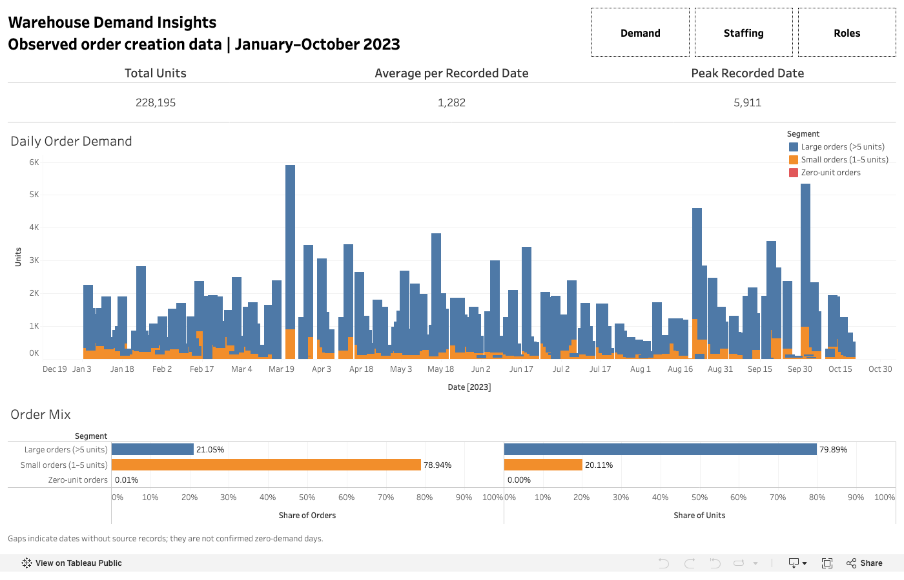
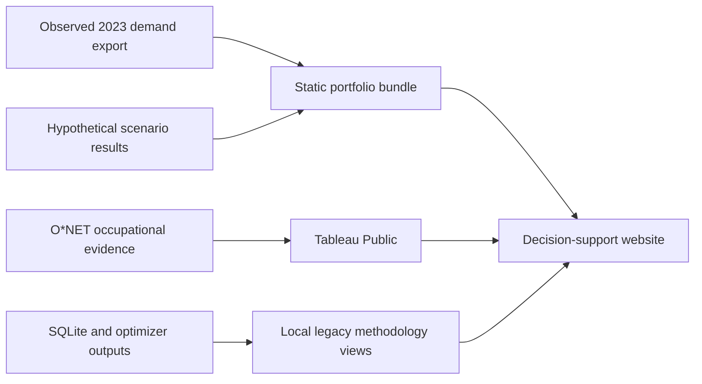

# Workforce Capacity Planner

**Do three warehouse sites have enough workers for the expected workload, and if not, what is the cheapest safe fix?**

This repo is a three part series on fulfillment operations:

1. **Forecast demand.** How much work is coming? (`scripts/forecast_demand.py`, see Technical details)
2. **Plan capacity.** Do the sites have enough workers? (this page)
3. **Protect parcels on the middle mile.** When trucks run late, which parcels are at risk and what is the cheapest fix? ([middle_mile/](middle_mile/README.md)) With the 6 worker plan, trucks cause 242 late parcels; with 10 workers, only 32, because understaffing leaves no time to absorb a late truck.

## The answer

Each modeled site covers at least 95% of its workload on most days, but none removes every shortfall hour across the recorded 2023 workload. The analysis found two staffing options:

| Option | Workers | Overtime | Stress cases passed | Modeled cost |
| --- | ---: | --- | ---: | ---: |
| Affordable base case | 6 | Up to 2 hours | 12 of 36 | $106,326 |
| Lowest risk | 10 | Up to 2 hours | 36 of 36 | $176,616 at most |

Choose the 6 worker plan when productivity is near 40 units per productive hour and attendance is stable. Choose the 10 worker plan when low productivity or two worker absence is possible. See [DECISION_ANSWER.md](DECISION_ANSWER.md) for the site by site answer.

## See it

- [Live site](https://vmtri15.github.io/workforce-capacity-planner/)
- [Tableau Public dashboard](https://public.tableau.com/views/WarehouseWorkforceCapacityPlanner/DemandInsights?:showVizHome=no)



## What is real and what is modeled

- **Observed:** the 2023 order dates, units, and order mix.
- **Modeled:** how demand is split across the three sites, staffing, productivity, attendance, timing, service level, and cost. These are explicit assumptions, not records from a real company.
- **External context:** labor market data (QWI) and process timing studies. They do not describe these sites.

The result is a planning answer under stated assumptions. It does not prove how many workers a real site needs.

## How it works

1. Load the 2023 demand data and public labor data into SQLite.
2. Size a fixed staffing plan from the 95th percentile of recorded daily demand.
3. Replay that plan under low, base, and high productivity.
4. Use the OR Tools CP-SAT solver to choose overtime, temporary shifts, cross training, hiring, and transfers.
5. Test the chosen options on a later time period and across 36 stress cases.

## Tech stack

Python, SQL (SQLite), Google OR Tools, Tableau Public, HTML and JavaScript, GitHub Pages.

## Run it locally

```bash
python3 scripts/serve_dashboard.py
```

Then open http://127.0.0.1:8765. Everything below is technical detail for rebuilding the data and rerunning the models.

## Ask the Planner: questions in plain English

`ask_the_planner/` lets a manager ask the planner database a question in plain English, for example "Which site has the most shortfall hours?". It writes the SQL, runs it read only, and answers in a sentence. It uses the open source Vanna 2.0 library with Google Gemini. My work is the layer on top: a business glossary, a 30 question test set with answers checked by hand, an accuracy run, and a failure review.

**How accurate is it?** Tested on 30 manager questions with gemini-3.1-flash-lite (a small free model):

| | Without glossary | With glossary |
| --- | ---: | ---: |
| Correct answers (of 28 answerable) | 12 (43%) | 16 (57%) |
| Declined the 2 questions the data cannot answer | 1 of 2 | 2 of 2 |

The glossary fixed 5 questions and broke none. Most remaining errors have one cause: the database holds three planning runs (low, base and high productivity), and the model often added all three together instead of using the base case, so its totals came out three times too large. See [FAILURE_REVIEW.md](ask_the_planner/FAILURE_REVIEW.md) for every failure and why.

**When you can trust it**
- Reference facts: sites, demand shares, assumptions, wages, data sources. With the glossary it got all of these right.
- Questions that name the case, such as "in the low productivity case".
- Always read the SQL it prints. If a total uses daily_capacity_results, staffing_plans or modeled_daily_workload without a run_id or productivity_case filter, it has mixed the three runs and the number is wrong.

**When you cannot trust it**
- Totals and counts where no case is named. These were wrong in most tests.
- Anything outside the database: 2023 figures, actual staffing, hiring advice. With the glossary it says so, but check.
- It answers from the modeled 2011 network database, not from the 2023 decision in DECISION_ANSWER.md.

**Run it.** Put your Gemini key in a `.env` file in the project root (`GEMINI_API_KEY=...`, the file is gitignored), then:

```bash
.venv/bin/python ask_the_planner/build_eval_db.py
.venv/bin/python ask_the_planner/ask.py "Which site has the most shortfall hours?" --db ask_the_planner/eval_db/planner_for_eval.db
.venv/bin/python ask_the_planner/evaluate.py --fresh
```

**In the dashboard.** Start the local site with the project's Python, `.venv/bin/python scripts/serve_dashboard.py`, and open http://127.0.0.1:8765. The "Ask the planner" page takes live questions when the key and database are found, and shows the answer, the SQL it ran and the result table. The key stays on your machine, so on the public GitHub Pages site the same page shows saved answers from the evaluation instead.

Vanna's own SQLite runner can write to the database and its Gemini code fails on current models, so this layer adds a read only runner and a small Gemini fix. Vanna's repository is archived, so the version is pinned to 2.0.2.

## Technical details

## Local dashboard

Run `python3 scripts/serve_dashboard.py` and open http://127.0.0.1:8765.
Use `--port 8766` if the default port is occupied. No additional runtime packages
are required. The default product experience uses the observed 2023 demand
export and precomputed staffing cases. The menu follows the three part series:
a home page with the answer and a plan picker that follows one staffing choice
through the warehouse, the stress tests and the trucks; the demand overview and
demand forecast (model leaderboard, next 20 days with the 80% range and P90, and
what forecast error costs in staffing); network capacity and scenario comparison;
the middle mile (late parcels by cause and the trucks to watch); plus Ask the
planner, Tableau reporting and methodology. Each page has a URL (`#forecast`,
`#middlemile`), works on a phone, and has light and dark themes (it follows the
visitor's system setting until they use the toggle).
The link preview image is drawn by `scripts/build_social_image.py` from the saved
results; rerun it after the numbers change. The older 2011 network model is retained in the codebase for
reproducibility but is intentionally excluded from the portfolio navigation. The
app does not run new optimizations.
The server binds to localhost and only serves the dashboard assets and data API.
The browser smoke check is `node scripts/check_dashboard.cjs` with Playwright
available and the server running on port 8765.

### Optional OpenAI explanation

The Recommendations view can translate the saved decision artifact into a short
manager-facing explanation. The optimizer and validation remain authoritative;
OpenAI does not calculate staffing or change the recommendation. Start the local
server with a server-side key:

```bash
OPENAI_API_KEY="your-key" python3 scripts/serve_dashboard.py
```

Set `OPENAI_MODEL` to override the default `gpt-5-mini`. The feature is hidden
when no key is configured. Never add the key to frontend code, `.env` tracked by
Git, or GitHub Pages; a public interactive deployment requires a separate secure
backend or serverless endpoint.

### 2023 network capacity replay

Run `python3 scripts/build_2023_network_capacity.py` to rebuild the portfolio's
site-level capacity view. It applies all retained 2023 observed orders and units
to the three modeled sites using the documented QCEW employment-share proxy. A
fixed staffing plan is sized from the 95th percentile of recorded daily demand,
then replayed under low, base, and high productivity sensitivities.

The replay excludes dates without source records. Site demand, staffing,
productivity, wages, and resulting capacity gaps are modeled assumptions, not
observed facility operations or recommended headcount. Results are written to
`data/processed/network_capacity_2023.json` and copied into the static portfolio
bundle by `scripts/build_static_dashboard.py`.

### Public portfolio build

The modern demand, comparison, recommendation, methodology, and Tableau views
also work as a static site. Build the API-free data bundle with:

```bash
python3 scripts/build_static_dashboard.py
python3 -m http.server 8766 --directory dashboard
```

Then open http://127.0.0.1:8766. The static build intentionally hides the local
SQLite data register and legacy network model. The GitHub Pages workflow in
`.github/workflows/pages.yml` rebuilds the bundle and publishes `dashboard/`
after a push to `main`. Directly opening `dashboard/index.html` with a `file://`
URL is unsupported because browsers block local data requests.

### Product architecture



The public experience keeps observed demand, modeled scenarios, and external
occupational evidence visibly separate. It does not expose the local database,
run new optimization, or prescribe staffing levels.

### Revised packing scenarios

Run `.venv/bin/python scripts/run_packing_optimization.py` to solve the three
12/24/48-unit packing-job sensitivities. This writes a separate
`data/processed/packing_optimization_results.json`; the legacy baseline remains
available. The dashboard workload-model selector uses these outputs after a
reload. The browser smoke test expects these three outputs and Google Chrome.
These are uncalibrated assumptions, not measured packing rates or carton sizes.
Picking remains at the base productivity case. Paid-time availability is applied
once on the capacity side. See [PACKING_INTEGRATION_RESULTS.md](docs/validation/PACKING_INTEGRATION_RESULTS.md) for limitations.

Start with:

- [DECISION_ANSWER.md](DECISION_ANSWER.md) for the current decision and result.
- [ROADMAP.md](ROADMAP.md) for the build sequence.
- [docs/README.md](docs/README.md) for research, assumptions, data notes, and validation evidence.

When the project changes, update the relevant file before starting a new implementation phase. Keep assumptions and open questions separate from verified results.

## Local data and credentials

- `data/reference/onet_db_31_0_excel.zip` is the downloaded O*NET Database release 31.0. It provides local occupation, task, skill, and work-context data, so an O*NET API key is not required for the first build.
- Copy `.env.example` to `.env` and set `CENSUS_API_KEY` locally. Do not commit `.env` or paste its key into chat.
- Raw downloaded and generated data belongs in `data/raw/` and is ignored by Git. Keep source URLs, release dates, and transformations documented in the data dictionary.

## Build the data foundation

```bash
python3 scripts/build_database.py
```

This creates `data/workforce_planner.db` from the saved inputs and runs the
required data-quality checks. See [DATA_SCHEMA.md](docs/data/DATA_SCHEMA.md) for table lineage, row
counts, and limitations.

Run the Phase 2B planning engine after building the database:

```bash
python3 scripts/run_planning_engine.py
```

The engine writes three fixed-staffing productivity cases to the database.
Query `planning_run_summary` for the headline results and
`planning_quality_results` for the engine checks. See [PHASE_2B_RESULTS.md](docs/validation/PHASE_2B_RESULTS.md) for
the current interpretation and limitations.

For the preliminary Phase 3 staffing comparison, run
`python3 scripts/compare_staffing_options.py` after the planning engine.
It saves `data/processed/staffing_option_comparison.json`; assumptions, research,
results and remaining optimization work are in [STAFFING_OPTIONS_RESEARCH.md](docs/validation/STAFFING_OPTIONS_RESEARCH.md).

Phase 3B adds synthetic rosters and constrained overtime/temporary-shift optimization:

```bash
python3 -m venv .venv
.venv/bin/python -m pip install -r requirements.txt
.venv/bin/python scripts/run_optimization.py
PYTHONPATH=src .venv/bin/python -m unittest discover -s tests -v
```

Build the database and run the planning engine first. Edit scenario policies in
`config/optimization.json`. Auditable actions and solver statuses are saved in
`data/processed/optimization_results.json`; see [PHASE_3B_RESULTS.md](docs/validation/PHASE_3B_RESULTS.md) for the
research, synthetic-data boundaries, results and remaining work.

Phase 3C adds cross-training, paid fixed-term hiring and transfers:

```bash
.venv/bin/python scripts/run_network_optimization.py
```

The new action controls are in `config/workforce_actions.json`. Results and
worker-level actions are saved in `data/processed/network_optimization_results.json`.
See [PHASE_3C_RESULTS.md](docs/validation/PHASE_3C_RESULTS.md) for research, assumptions, interpretation and validation.
The script includes a slower-travel sensitivity and preserves FEASIBLE versus
OPTIMAL solver labels.

Demand forecast and the cost of forecast error:

```bash
python3 scripts/forecast_demand.py
```

This forecasts daily units 4 weeks ahead (20 weekdays) with a rolling origin backtest of 25 forecast dates. It compares two simple baselines with Prophet, ARIMA, XGBoost and a Ridge regression, using only past data at each origin, and adds a P90 quantile forecast: the demand level that 90% of days should stay at or below. Monday to Friday only: 7,428 Sunday units are left out, and dates with no source records are treated as unknown, not zero. Results are written to `data/processed/demand_forecast/`.

What the backtest found:

- Daily demand is hard to predict. Every model has a daily WAPE (total error divided by total demand) between 60% and 64%, and the simple 20 day mean is within 3 points of the best model. Ridge regression (63.3%) ties the others. ARIMA is best, but its forecast is close to a flat line. Its error on the 4 week total is about 21%.
- With under one year of data there is no yearly seasonality, so no same week last year baseline exists.
- Sizing headcount on the point forecast misses the 95% on time target in 60% of the 4 week windows (ARIMA), because a smooth forecast hides spikes and a level shift in August and September.
- Adding a buffer helps. Sizing on ARIMA forecast times 1.5 gives 97% mean on time units, misses the target in 20% of windows, and costs about one extra worker on average. One worker is $3,520 per 4 weeks at the hypothetical wage in `config/staffing_cost_scenarios.json`.
- The low and high band (10th and 90th percentile of actual divided by forecast) covered only 60% of days on the later origins, against an 80% target. Treat it as too narrow.
- The P90 quantile forecast is better calibrated: 87.6% of actual days stayed at or below it, against a 90% target. Sizing headcount on P90 alone misses the target in only 8% of windows, against 20% for the forecast times 1.5, but it staffs about 2.8 workers more than hindsight would.

Method check on 5 years of data. The 2023 data is under one year, so `python3 scripts/forecast_method_check.py` runs the same backtest on the Kaggle "Historical Product Demand" file (4 warehouses, 2012 to 2016, about 52 forecast windows each). This is a manufacturing product demand series, so it tests the method only and is not converted to footwear units. The file is not in the repo; download it from Kaggle into `data/raw/historical_product_demand/`. Results are in `data/processed/demand_forecast/method_check_product_demand_scores.csv`.

- Models beat the simple baselines, but only a little. Ridge regression is narrowly best: 42.8% daily WAPE averaged over the four warehouses, against 44.3% for Prophet. On all warehouses combined, daily WAPE is 26.1% for Ridge and 26.5% to 27.1% for Prophet, ARIMA, and XGBoost, against 27.6% for the plain 20 day mean, 32.3% for same weekday last year, and 34.6% for same weekday last week.
- Single warehouses are much harder, at 26% to 66% depending on the warehouse. That is close to the 60% found on the 2023 footwear data, so the short 2023 history is not the only reason for the poor accuracy. Daily demand at one site is noisy, and combining many products smooths it.
- Same weekday last year did worse than the 20 day mean, so yearly seasonality is weak in this data.

Headcount costs use the hypothetical scenario inputs, not observed staffing.

Forecast to staffing link. `python3 scripts/forecast_staffing_link.py` (run after `forecast_demand.py`) chooses a standing plan from the forecast, then replays it on the demand that really arrived. The plan is one of the 30 policies in `compare_service_costs.py`: permanent workers, an overtime limit, and a temporary shift limit, with the planner's reactive overtime and temp rules. It uses the same hypothetical wages and the base case of 40 units per hour. Results are in `data/processed/demand_forecast/staffing_link_summary.csv`. Over 25 four week windows:

| Plan | Mean on time units | Windows below 95% | Mean cost per window |
| --- | ---: | ---: | ---: |
| Chosen on the forecast (ARIMA) | 96.3% | 24% | $41,691 |
| Chosen on the P90 quantile forecast | 98.1% | 20% | $46,469 |
| 6 workers, up to 2 overtime hours (fixed) | 98.4% | 24% | $42,026 |
| 6 workers, overtime, up to 4 temps kept available (fixed) | 99.7% | 0% | $42,285 |
| Chosen with hindsight on actual demand | 98.7% | 0% | $42,030 |
| 10 workers, up to 2 overtime hours (fixed) | 100% | 0% | $69,485 |

- The forecast always picked the cheapest plan, 6 workers with no overtime and no temps, because the forecast is smooth. When demand roughly doubled in July to September, that plan fell to 86% to 89% on time in 6 of 25 windows. Hindsight chose the same 6 workers plus temps.
- A buffer of 1.5 on the forecast did not fix this. Neither did the P90 quantile forecast: it bought more permanent staff and cost about $4,400 more per window than hindsight, yet still missed the target in 20% of windows, because no forecast saw the July to September surge coming.
- Keeping overtime and temp shifts available (6 workers, 2 overtime hours, up to 4 temps) reached 99.7%, never missed the target, and cost only about $255 more per window than hindsight. The 10 worker plan costs about $27,000 more per window.
- So the forecast error costs service, not money: the surges it misses must be absorbed by flexible capacity. The standing headcount matters less than keeping that flexibility available. This uses one year of one site's data and 25 overlapping windows, so treat it as a strong hint, not proof.


Forecast to CP-SAT link (legacy 2011 model). The CP-SAT optimizer runs on the older 2011 retailer data (56 day window, Oct 14 to Dec 8, 2011, three modeled sites, synthetic roster), not on the 2023 footwear data. `python3 scripts/forecast_cpsat_link.py` forecasts that window from the 22 months before it, feeds each forecast through the planning engine and optimizer, and compares the result with the actual demand. Results are in `data/processed/demand_forecast/cpsat_link_summary.csv`. It needs the `.venv` setup below (ortools). Base productivity case only.

| Forecast | Headcount | Planned on forecast, replayed on actual: days meeting target | Shortfall | Forecast headcount plus day of optimization |
| --- | ---: | ---: | ---: | --- |
| Hindsight (actual demand) | 60 | 100% | 0% | $510,042 total |
| Same weekday last year | 53 | 95.1% | 1.6% | feasible, $455,009 total |
| Prophet | 50 | 93.1% | 2.7% | feasible, $434,773 total |
| Mean of last 20 days | 35 | 67.0% | 18.9% | infeasible |

- Headcount is sized at the 95th percentile of daily workload, so it depends on the forecast showing peaks. A flat forecast (the 20 day mean) has no peaks and sizes only 35 positions. In this Christmas window that left 19% of the workload uncovered, and even full overtime and temp use could not recover it.
- The two forecasts that capture seasonality sized 50 to 53 positions and missed the target on 5% to 7% of site role days when planned in advance, with 1.6% to 2.7% of workload short.
- If overtime and temp shifts are then optimized once the daily demand is known, those two plans meet the target at a total cost 11% to 15% below the hindsight plan. That says more about the model than about the forecast: the 95th percentile sizing rule is conservative, and overtime and temp shifts are cheap in this model. The wages, temp pool, and roster are documented assumptions, not observed.
- This is one window, in the peak season, on legacy data. Treat it as an illustration of how forecast error moves through the optimizer, not as a validated result.

Refresh the Census QWI extract before rebuilding when needed:

```bash
python3 scripts/fetch_census_qwi.py
python3 scripts/build_database.py
```

An isolated footwear demand/absence/backlog experiment is available with
`python3 scripts/build_footwear_scenario.py`. See
[FOOTWEAR_BACKLOG_SCENARIO.md](docs/validation/FOOTWEAR_BACKLOG_SCENARIO.md) for source attribution,
assumptions and results. It does not modify the existing dashboard or optimizer.

The five evidence-first operational analyses are documented in
[OPERATIONAL_ACTIONS.md](docs/validation/OPERATIONAL_ACTIONS.md): order segmentation, peak-response
comparisons, location-review priorities, experimental packing reference and
duplicate-data sensitivity. Reproduce with `scripts/analyze_operational_actions.py`.

Explicit hypothetical staffing and operating-day service scenarios are defined in
`config/footwear_scenarios.json`. Run `python3 scripts/run_service_scenarios.py`;
see [SERVICE_SCENARIOS.md](docs/validation/SERVICE_SCENARIOS.md) for definitions and results.

Compare hypothetical permanent capacity, overtime and delayed temporary shifts
with `python3 scripts/compare_service_costs.py`. See
[SERVICE_COST_COMPARISON.md](docs/validation/SERVICE_COST_COMPARISON.md) for costs, stress results
and limitations; rates and policy limits are in `config/staffing_cost_scenarios.json`.

Final price and chronological checks are in [RECOMMENDATION.md](docs/validation/RECOMMENDATION.md).
Run `python3 scripts/validate_recommendations.py`. The preferred policies remained
stable across tested prices but the two frozen choices did not meet their targets
in every later-period case. Run `python3 scripts/build_decision_answer.py` after
validation to regenerate the site-by-site answer and post-hoc replacement-policy
comparison shown in [DECISION_ANSWER.md](DECISION_ANSWER.md).
